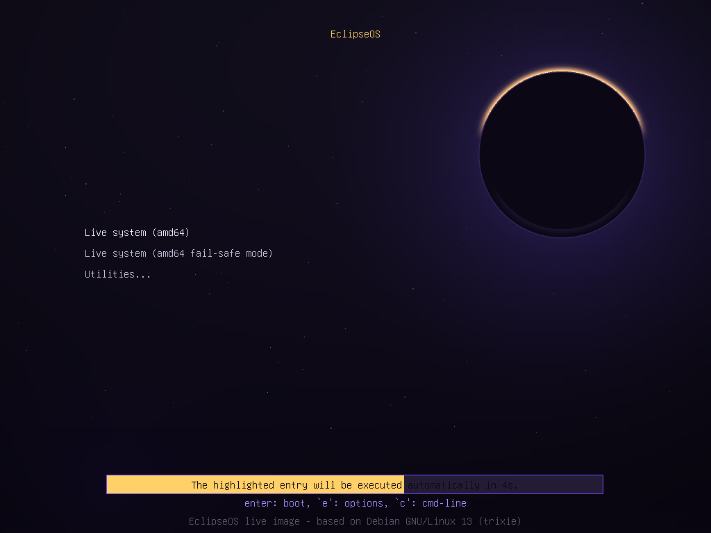
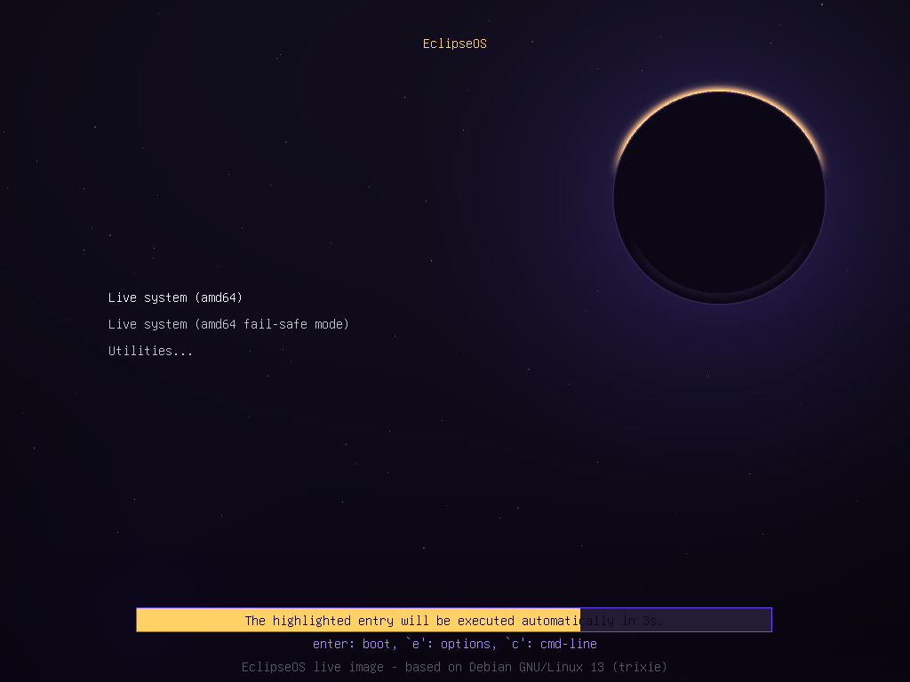
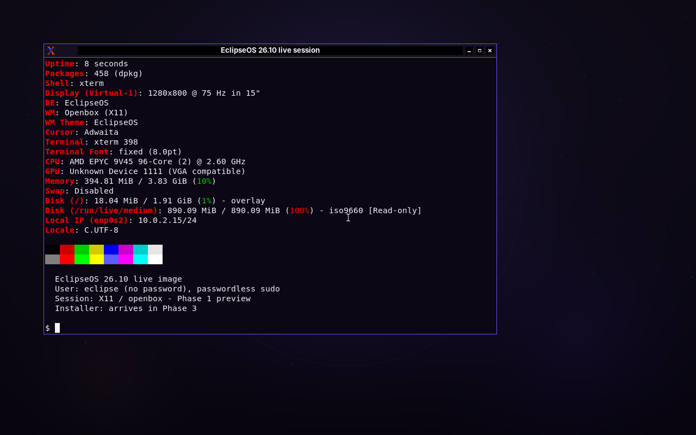
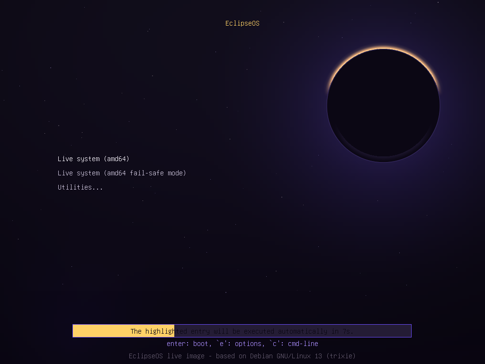
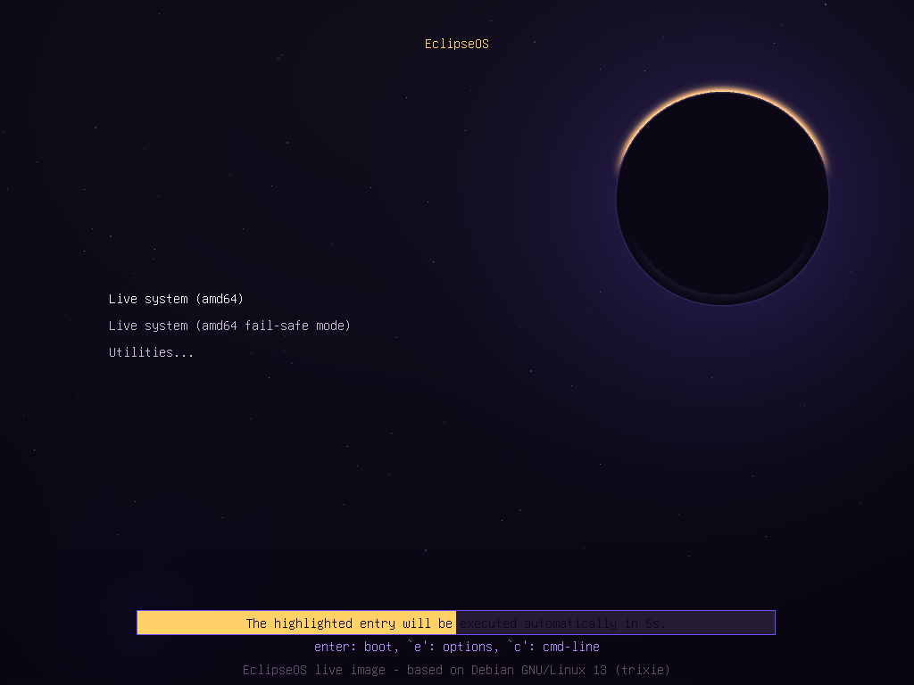
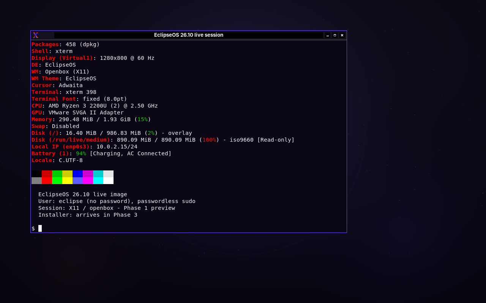

# Phase 1 evidence

This directory records the first real build and boot of the EclipseOS 26.10
live image. Nothing here is a mock-up: the build and QEMU files come from the
GitHub Actions run linked below, and the VirtualBox files come from the
separate local 2 GiB EFI/BIOS tests described later. The ISO checksum was
verified after download.

## Build

| Item | Value |
| --- | --- |
| GitHub Actions run | [run 39359532446](https://github.com/nexarift-cmd/eclipseos/actions/runs/39359532446) |
| Result | success |
| Commit | `c874d77fd4d8fbb13ede8cad4ffdedbf1862153a` |
| Build host | Debian 13 container on `ubuntu-24.04` |
| ISO | `eclipseos-26.10-amd64.iso` |
| ISO size | 933,328,896 bytes (890.1 MiB) |
| SHA256 | `f8bbf22a9354b2d9c3524ef11a3de59040a70d35011bc617d235ffa47eb4ac4a` |
| SHA256 check | passed locally after downloading the artifact |
| Licence mode | `redistributable-firmware` (default build) |
| Firmware packages | 24 approved `non-free-firmware` packages |

The live-build build log is [`build.log`](build.log); the short live-build
configuration log is [`config.log`](config.log). The checksum and build-info
files are stored beside this document as
[`eclipseos-26.10-amd64.iso.sha256`](eclipseos-26.10-amd64.iso.sha256) and
[`eclipseos-26.10-amd64.iso.buildinfo`](eclipseos-26.10-amd64.iso.buildinfo).
The 933 MB ISO itself is not committed; it is published as the
`eclipseos-26.10-amd64-default` artifact on the run page.

Key build-log lines:

```text
0300-licences: 24 approved non-free-firmware package(s)
9900-verify: all Phase 1 checks passed
P: UEFI Secure Boot support enabled.
P: Build completed successfully
Built: /work/eclipseos-26.10-amd64.iso
SHA256: f8bbf22a9354b2d9c3524ef11a3de59040a70d35011bc617d235ffa47eb4ac4a
```

## Strict FOSS build

A second `workflow_dispatch` run built both flavours from the same commit.
Its default job reproduced the **same** default SHA256 shown above, and its
strict job built a main-only image with zero non-free firmware packages.

| Item | Strict value |
| --- | --- |
| GitHub Actions run | [run 39362243286](https://github.com/nexarift-cmd/eclipseos/actions/runs/39362243286) |
| Result | success (default and strict jobs) |
| ISO size | 486,973,440 bytes (464.4 MiB) |
| SHA256 | `67eff472ca704d5ed72ce6119eda71303470eeb25bd142f129eb555bd01f1edd` |
| SHA256 check | passed locally after downloading the artifact |
| Archive areas | `main` only |
| Licence mode | `strict-foss` |
| Non-free firmware | 0 packages (`0300-licences`) |
| QEMU UEFI | PASS, marker at 24.2 s |
| QEMU BIOS | PASS, marker at 24.2 s |

The strict build log, checksum, build-info and QEMU evidence are in
[`strict/`](strict/README.md). The default job in the same run produced the
same SHA256 as run #3, which is useful reproducibility evidence but does not
prove bit-identical builds in general.

## QEMU boot tests

The workflow ran the ISO twice on QEMU/KVM, once with OVMF (UEFI) and once
with SeaBIOS (BIOS). Both boots reached the live desktop, started the X11
session under LightDM/openbox, and reported zero failed systemd units.

| Firmware | Marker seen | Result | Evidence |
| --- | --- | --- | --- |
| UEFI (OVMF) | 22.1 s | PASS | [`qemu-uefi-result.json`](qemu-uefi-result.json), [`qemu-uefi-serial.log`](qemu-uefi-serial.log) |
| BIOS (SeaBIOS) | 22.1 s | PASS | [`qemu-bios-result.json`](qemu-bios-result.json), [`qemu-bios-serial.log`](qemu-bios-serial.log) |

Marker in both runs:

```text
ECLIPSEOS_BOOT_OK stage=desktop session=x11 failed_units=0
```

QEMU UEFI GRUB menu:



QEMU UEFI live desktop:


QEMU BIOS GRUB menu:



QEMU BIOS live desktop:



## VirtualBox boot tests

VirtualBox 7.2.20 was used on the Windows test host. Both firmware modes were
created with the same settings as `scripts/create-vbox-vm.sh`: 2 vCPUs,
128 MiB video RAM, VMSVGA, a 25 GiB VDI disk, and the ISO attached to SATA.
Because this specific host has only 5.1 GB of visible RAM, the tests used
2048 MiB instead of the script's 4096 MiB target. The 4 GiB VM could not be
started on this host; see
[`virtualbox-host-limit.txt`](virtualbox-host-limit.txt).

| Firmware | Result | Evidence |
| --- | --- | --- |
| EFI | Reached the live desktop in about 60 s | [`virtualbox-efi-result.json`](virtualbox-efi-result.json) |
| BIOS | Reached the live desktop in about 60 s | [`virtualbox-bios-result.json`](virtualbox-bios-result.json) |

VirtualBox EFI GRUB menu:



VirtualBox EFI Plymouth splash:


VirtualBox EFI live desktop:


VirtualBox BIOS GRUB menu:



VirtualBox BIOS live desktop:



The BIOS 30-second screenshot captured kernel log text rather than Plymouth;
the desktop was present at 60 seconds. The log contained `vmwgfx` warnings
because VirtualBox was running under Windows' Hyper-V/NEM path on this
low-memory host. The graphical session still came up. The same warning was
not seen in QEMU, which uses a different virtual graphics adapter.

## Known non-fatal warnings

The build log contains normal live-build/package-install warnings:

- `plymouth: The plugin label-pango.so is missing`; the EclipseOS theme uses
  the script/image path, and the Plymouth screenshot above shows it rendering;
- `dpkg-divert`/`update-rc.d` warnings from the Debian live stack;
- live-build's "essential packages will be removed" warning while it installs
  and then removes the temporary Secure Boot helper packages for the EFI image.

None stopped the build or boot, and both QEMU tests reached the desktop.

## What this proves, and what it does not

Proven:

- `make iso` completed on Debian 13 and produced the ISO, checksum and
  build-info;
- the published SHA256 matches the downloaded ISO;
- both UEFI and BIOS paths boot the same hybrid ISO in QEMU;
- the custom GRUB theme and branded Plymouth splash appear;
- the live user session reaches the X11 desktop with zero failed units;
- VirtualBox EFI and BIOS both boot the same ISO to the live desktop at
  2048 MiB;
- a strict `STRICT_FOSS=1` image built from `main` only, contains zero
  non-free firmware packages, and passes both QEMU boots.

Not proven here:

- the 4096 MiB VirtualBox VM on this host; it fails before guest execution
  because the host cannot allocate the guest RAM;
- Secure Boot signing, enrollment and boot; the QEMU tests did not enable
  Secure Boot;
- VirtualBox Guest Additions integration (deliberately not bundled);
- installation, because Calamares is Phase 3.

## Reproduce

On a Debian 13 host:

```bash
make doctor
make static-check
make iso
sha256sum -c eclipseos-26.10-amd64.iso.sha256
make test-all
```

The login is `eclipse` with no password. The installer, and any real installed
account, is not part of this image yet.
