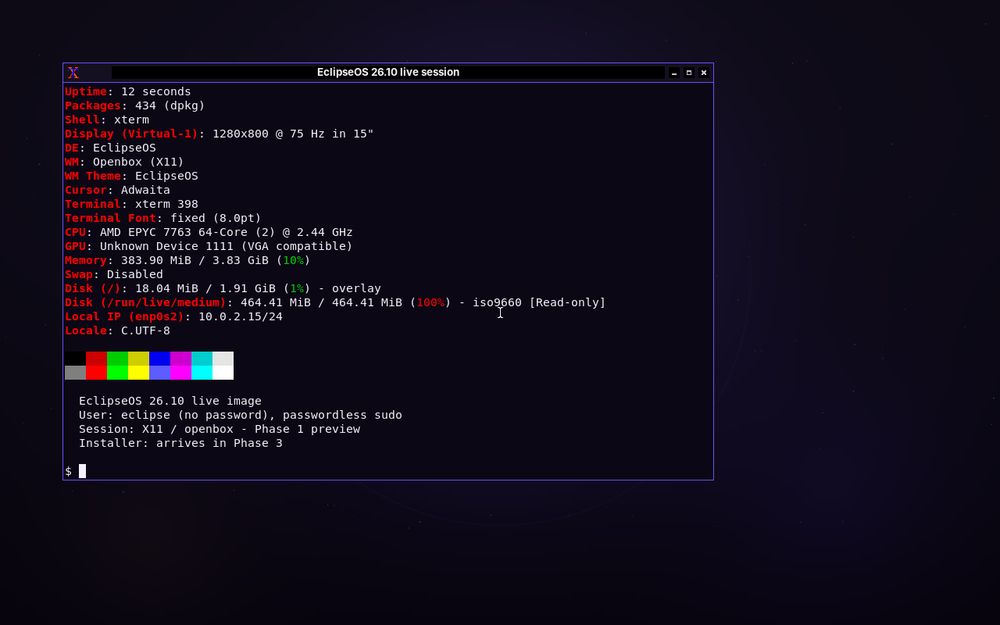

# Strict FOSS build evidence

This directory records the `STRICT_FOSS=1` build from
[run 39362243286](https://github.com/nexarift-cmd/eclipseos/actions/runs/39362243286),
commit `c874d77fd4d8fbb13ede8cad4ffdedbf1862153a`.

## Result

| Item | Value |
| --- | --- |
| Job | `EclipseOS (strict)` |
| Result | success |
| ISO | `eclipseos-26.10-amd64.iso` (strict flavour) |
| ISO size | 486,973,440 bytes (464.4 MiB) |
| SHA256 | `67eff472ca704d5ed72ce6119eda71303470eeb25bd142f129eb555bd01f1edd` |
| SHA256 check | passed locally after artifact download |
| Archive areas | `main` only |
| Licence mode | `strict-foss` |
| Non-free firmware | 0 packages |
| QEMU UEFI | PASS; marker at 24.2 s, zero failed units |
| QEMU BIOS | PASS; marker at 24.2 s, zero failed units |

The CI log records (`ci-summary.txt` is a selected, timestamped excerpt):

```text
Firmware list: disabled (STRICT_FOSS=1)
lb config ... --archive-areas main --parent-archive-areas main ...
0300-licences: 0 approved non-free-firmware package(s)
9900-verify: all Phase 1 checks passed
Built: /work/eclipseos-26.10-amd64.iso
SHA256: 67eff472ca704d5ed72ce6119eda71303470eeb25bd142f129eb555bd01f1edd
```

The strict run's default job independently produced the same default SHA256
as run #3:
`f8bbf22a9354b2d9c3524ef11a3de59040a70d35011bc617d235ffa47eb4ac4a`.
That is evidence of repeatability for this pair of builds, not a general
bit-reproducibility guarantee.

## Evidence files

- [`build.log`](build.log) — live-build log from the strict job;
- [`config.log`](config.log) — shows `--archive-areas main` only;
- [`ci-summary.txt`](ci-summary.txt) — selected CI log lines with timestamps;
- [`eclipseos-26.10-amd64.iso.buildinfo`](eclipseos-26.10-amd64.iso.buildinfo);
- [`eclipseos-26.10-amd64.iso.sha256`](eclipseos-26.10-amd64.iso.sha256);
- [`qemu-uefi-result.json`](qemu-uefi-result.json) and
  [`qemu-uefi-serial.log`](qemu-uefi-serial.log);
- [`qemu-bios-result.json`](qemu-bios-result.json) and
  [`qemu-bios-serial.log`](qemu-bios-serial.log).

Strict UEFI desktop:


Strict BIOS desktop:



The strict ISO omits the default build's redistributable firmware, so some
Wi-Fi, GPU, audio and Bluetooth hardware will not work. That trade-off is
documented in [`../../../licenses.md`](../../../licenses.md). VirtualBox acceptance
was performed on the default ISO only; the strict image was boot-tested in
QEMU UEFI and BIOS.
