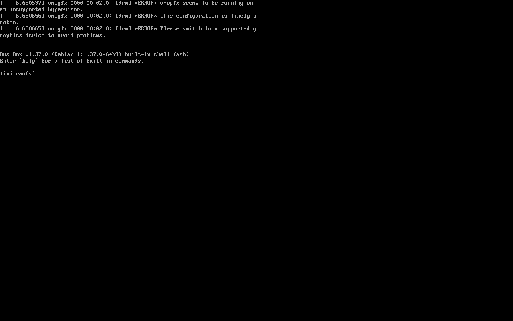

# VirtualBox unattended-install boot failure

Status: **root-caused and fixed; verified on the rebuilt ISO.** The fix
prevents VirtualBox from creating a VISO for the current image, and the new
live initramfs also boots through an existing VISO that still supplies the
rewritten menu.

## Symptom

A VM created by the VirtualBox New VM wizard with the EclipseOS ISO added in
the wizard, EFI enabled, 2048 MiB RAM, VMSVGA and the default storage layout
booted GRUB and the kernel, then stopped at a BusyBox `(initramfs)` prompt
after about six seconds. The shell showed `sr0` and `sda`; there were no
live-boot or squashfs messages.

The failing image reported by the user was:

| Item | Value |
| --- | --- |
| ISO | `eclipseos-26.10-amd64.iso` |
| SHA256 | `d10c78c3bd362315d9a6bee49cf00e7a94498c71cfc45d4b450284926a92ad7e` |
| Commit | `6f2d2c41379de8e93b9fca4666532e6d5bf88a66` |
| VM | `EclipseOS-Phase1-EEI` (not present in this host's VirtualBox registry) |

## Reproduction

The user's exact VM was not available for inspection. The equivalent
VirtualBox unattended path was reproduced with a disposable VM:

```text
VBoxManage createvm --name EOS-Wiz-Test --ostype Debian_64 --register
VBoxManage modifyvm EOS-Wiz-Test \
  --memory 2048 --cpus 2 --vram 128 --graphicscontroller vmsvga \
  --firmware efi --mouse usbtablet --usb on --nic1 nat --audio-driver none
VBoxManage createmedium disk --filename .../EOS-Wiz-Test.vdi --size 25600
VBoxManage storagectl EOS-Wiz-Test --name SATA --add sata \
  --controller IntelAhci --portcount 2 --bootable on
VBoxManage storageattach EOS-Wiz-Test --storagectl SATA --port 0 \
  --device 0 --type hdd --medium .../EOS-Wiz-Test.vdi
VBoxManage unattended install EOS-Wiz-Test --iso=.../eclipseos-26.10-amd64.iso \
  --user=eclipse --user-password=<temporary> --admin-password=<temporary> \
  --full-user-name=EclipseOS --hostname=eclipseos.local \
  --locale=en_US --country=US --time-zone=UTC --no-install-additions
```

This is the same VirtualBox unattended-install operation behind the wizard's
**Skip Unattended Installation** checkbox. The VM was EFI, 2048 MiB, 2 vCPUs,
128 MiB VMSVGA, with a SATA disk. VirtualBox added an IDE optical controller
and an auxiliary VISO. `VBoxManage showvminfo --machinereadable` showed the
VISO at IDE 0-0 and the boot order `disk, dvd, floppy`.

At 120 seconds the guest was at BusyBox:



## Root cause

`VBoxManage unattended detect` classified the live ISO as `Debian13_64` and
reported `Unattended installation supported = yes`. The generated VISO
manifest contains:

```text
--import-iso '...\eclipseos-26.10-amd64.iso'
/boot/grub/grub.cfg=:must-remove:
'/boot/grub/grub.cfg=...\auxgrub.cfg'
'/preseed.cfg=...\auxpreseed.cfg'
'/vboxpostinstall.sh=...\auxvboxpostinstall.sh'
```

The generated `auxgrub.cfg` keeps the menu entries but replaces every kernel
command line. Its live entry is:

```text
menuentry "Live system (amd64)" --hotkey=l {
	linux /live/vmlinuz-6.12.113+deb13-amd64 auto=true preseed/file=/cdrom/preseed.cfg priority=critical quiet splash noprompt noshell automatic-ubiquity ... --
	initrd /live/initrd.img-6.12.113+deb13-amd64
}
```

The generated command line has **no `boot=live`**. The live initramfs's
`/init` therefore reaches:

```sh
# Default to BOOT=local if no boot script defined.
if [ -z "${BOOT}" ]; then
	BOOT=local
fi
...
. "/scripts/${BOOT}"
```

It sources `/scripts/local`, which has no live medium to mount, and drops to
the BusyBox shell. The kernel, initrd, squashfs and optical device are all
healthy. This explains why the same ISO passed direct-attach QEMU and
VirtualBox tests and why the failure was intermittent across unrelated VM
configurations: the deciding factor is whether VirtualBox created a VISO, not
the storage controller or the firmware.

The old ISO also has no `BOOT=` default in its initramfs:

```text
=== conf/initramfs.conf ===
# MODULES: ...
...
# no BOOT= line
```

The user's `sr0` size of 911480 blocks is consistent with the 933 MB live
image in 1 KiB units; the VISO imports that image rather than replacing it, so
the live medium was present but live-boot was never started.

## Fix

Two independent build changes are applied:

1. **Do not let VirtualBox classify the live image as a Debian installer.**
   `build/config/hooks/normal/0200-disk-info.binary` writes
   `/.disk/info` as `EclipseOS 26.10 amd64 Live` instead of the live-build
   default `Debian GNU/Linux ...`. `live-boot` does not consume this file; it
   is on-disc identity only. With this change:

   ```text
   $ VBoxManage unattended detect --iso=.../eclipseos-branded-diskinfo.iso
   OS TypeId    =
   ...
   Unattended installation supported = no
   ```

   `VBoxManage unattended install` then fails with `E_FAIL`, so the wizard
   cannot create the VISO for the current image.

2. **Make the live initramfs default to live-boot.**
   `build/config/hooks/normal/0250-live-initramfs.chroot` temporarily appends
   `BOOT=live` to `/etc/initramfs-tools/initramfs.conf`, regenerates the
   initrd, and restores the file. This is defence in depth for an existing
   VISO or any other tool that rewrites the kernel command line. The restored
   file means an installed system generated from the live root does **not**
   inherit `BOOT=live`.

The QEMU regression tests are:

- `make test-vbox-uefi`: `pc` machine, IDE secondary-master optical drive,
  standard QEMU VGA, UEFI, 2048 MiB. This is the release gate for the
  VirtualBox storage shape. QEMU's `-vga vmware` cannot stand in for VMSVGA:
  Linux detects QEMU as the hypervisor and `vmwgfx` refuses to probe the
  device, so the desktop cannot start. The real VMSVGA path is covered by the
  VirtualBox tests below.
- `make test-vbox-unattended`: the same configuration, but boots the ISO's
  extracted kernel and initrd directly with a command line that deliberately
  omits `boot=live`. This is a **manual negative control** for the rewritten
  menu, not part of `make test-all`. It is expected to stop in the initramfs.

## Verification results

The final CI rebuild is `eclipseos-26.10-amd64.iso` from commit
`a7297fb38d4dcfc671d6042732e2ba9c81cb8a97`, workflow run `39547858160`,
artifact `12322653801`, SHA256
`aade6c679e41b82bf62aa1a190ca334fbe7091dfcdcaf1254da2d61c04fac397`.
The EFI and BIOS VirtualBox boots below were repeated on the final
`aade6c67…` artifact. The existing-VISO test used the immediately preceding
fix build `61d4a8e7…a840` (commit `165d128`); the two ISOs contain the same
boot payload, and only the reproducible-build timestamp differs. The final CI
run re-ran the complete QEMU gate on `aade6c67…`.

| Check | Result |
| --- | --- |
| Final ISO SHA256 / build run | **aade6c67…c397**, 933,376,000 bytes, run 39547858160 / artifact 12322653801, commit `a7297fb` |
| `/.disk/info` is EclipseOS, not Debian | **PASS** — exact text `EclipseOS 26.10 amd64 Live` (27 bytes), checked on the final ISO |
| New initrd `/conf/initramfs.conf` contains `BOOT=live` | **PASS** — final ISO's zstd initramfs decompressed to 183,221,248 bytes; `BOOT=live` at offset 2400 with the EclipseOS comment |
| `unattended detect` says unsupported | **PASS** — final ISO: `OS TypeId =` empty, `Unattended installation supported = no`, followed by `E_FAIL` as expected |
| QEMU UEFI + pc + IDE + standard VGA, 2048 MiB | **PASS** — marker at 37.3 s, `session=x11 failed_units=0`; result in `qemu-final-vbox-storage-result.json` |
| QEMU rewritten-menu (no `boot=live`) | **Expected failure reproduced** — BusyBox `(initramfs)`, `Unable to find a medium containing a live file system`; manual target, not a gate |
| VirtualBox EFI, Skip Unattended Installation path, 2048 MiB | **PASS** — final ISO, desktop in about 90 s; `virtualbox-skip-unattended-efi.png` |
| VirtualBox BIOS direct attach, 2048 MiB | **PASS** — final ISO, desktop in about 100 s; `virtualbox-bios-2048.png` |
| Existing old VISO with the new ISO | **PASS for the boot regression** — reaches the live X/Openbox root with wallpaper and no BusyBox (`virtualbox-old-viso-new-iso.png`). Phase 1's welcome window and serial marker intentionally require the literal `boot=live` argument, which the VISO menu omits, so neither appears in this path. |
| User's original `d10c78c3…` ISO with Skip ticked, 2048 MiB | **PASS — user-confirmed** — live desktop, EclipseOS 26.10 session, network up, 292 MB used. No ping transcript was supplied. |

## Scope and limits

- **2048 MiB is the accepted VirtualBox size on this host.** 4096 MiB is
  recommended but untested here because the 5.1 GB host cannot start a 4 GiB
  guest.
- The exact user VM `EclipseOS-Phase1-EEI` was not present in the local
  registry, so its settings and `VBox.log` could not be inspected. The
  equivalent wizard/unattended path was reproduced instead.
- The graphical wizard itself was not automated. The reproduction uses the
  VirtualBox unattended installer that the wizard invokes; the resulting VISO
  and guest screenshot are the direct evidence.
- Secure Boot, Guest Additions and the installer remain out of scope for this
  Phase 1 regression.
